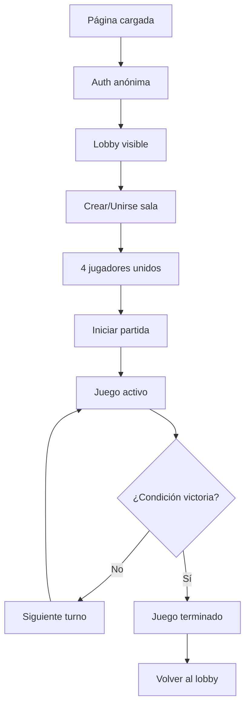

# 2v2 Card Game - Juego de Cartas Multijugador - Generado con IA

Un juego de cartas por turnos 2 vs 2 construido con HTML5, JavaScript vanilla y Firebase Firestore para multijugador en tiempo real.

## 🎮 Características

- **Multijugador en tiempo real**: 4 jugadores divididos en 2 equipos
- **Turnos estructurados**: Sistema de turnos automático y ordenado
- **Cartas variadas**: Sistema de cartas con efectos de ataque, curación y defensa
- **Sincronización**: Estado del juego sincronizado en tiempo real
- **Responsive**: Funciona en dispositivos móviles y desktop

## 🏗️ Estructura del Proyecto

```
├── index.html              # Estructura principal de la aplicación
├── style.css              # Estilos (mantenidos separados)
├── js/
│   ├── config.js          # Configuración de Firebase y constantes
│   ├── game.js            # Lógica principal del juego
│   └── utils.js           # Utilidades adicionales
└── README.md              # Documentación
```

## 🚀 Configuración e Instalación

### 1. Prerrequisitos

- Un proyecto de Firebase con Firestore habilitado
- Servidor web (puede ser local como Live Server de VS Code)

### 2. Configuración de Firebase

1. Ve a la [Consola de Firebase](https://console.firebase.google.com/)
2. Crea un nuevo proyecto o selecciona uno existente
3. Habilita Firestore Database
4. Ve a Configuración del proyecto > General > Tus apps
5. Agrega una aplicación web y copia las credenciales
6. Reemplaza las credenciales en `js/config.js`:

```javascript
export const firebaseConfig = {
  apiKey: "tu-api-key",
  authDomain: "tu-proyecto.firebaseapp.com",
  projectId: "tu-proyecto-id",
  // ... resto de configuración
};
```

### 3. Reglas de Firestore

Configura las siguientes reglas en Firestore para desarrollo:

```javascript
rules_version = '2';
service cloud.firestore {
  match /databases/{database}/documents {
    // Salas de juego
    match /rooms/{roomId} {
      allow read, write: if true; // Para desarrollo
      
      // Jugadores en la sala
      match /players/{playerId} {
        allow read, write: if true;
      }
      
      // Manos de los jugadores
      match /hands/{playerId} {
        allow read, write: if true;
      }
    }
    
    // Códigos de sala
    match /codes/{code} {
      allow read, write: if true;
    }
  }
}
```

**⚠️ IMPORTANTE**: Estas reglas son permisivas para desarrollo. En producción, implementa reglas de seguridad apropiadas.

## 🎯 Cómo Jugar

### 1. Crear una Sala
1. Ingresa tu nombre
2. Selecciona un equipo (A o B)
3. Haz clic en "Crear sala"
4. Comparte el código de 6 dígitos con otros jugadores

### 2. Unirse a una Sala
1. Ingresa tu nombre
2. Selecciona un equipo
3. Ingresa el código de sala
4. Haz clic en "Unirse"

### 3. Iniciar Partida
- Se necesitan exactamente 4 jugadores (2 por equipo)
- Solo el creador de la sala puede iniciar la partida
- Cada jugador comienza con 3 cartas

### 4. Jugabilidad
- Los turnos rotan automáticamente entre todos los jugadores
- En tu turno, puedes:
  - Jugar una carta de tu mano
  - Terminar tu turno sin jugar
- Al jugar una carta, robas automáticamente una nueva (si hay disponibles)
- El objetivo es reducir la vida del equipo enemigo a 0

## 🃏 Tipos de Cartas

| Carta | Efecto | Descripción |
|-------|--------|-------------|
| **Ataque +1** | Daño: 1 | Hace 1 de daño al equipo rival |
| **Ataque +2** | Daño: 2 | Hace 2 de daño al equipo rival |
| **Bola de Fuego** | Daño: 3 | Hace 3 de daño al equipo rival |
| **Curar +1** | Curación: 1 | Cura 1 punto a tu equipo |
| **Curación Masiva** | Curación: 2 | Cura 2 puntos a tu equipo |
| **Escudo** | Defensa: 1 | Evita daño (próxima versión) |

## 🛠️ Arquitectura del Código

### Clases Principales

- **`GameState`**: Manejo del estado local del jugador
- **`DOMManager`**: Gestión de elementos del DOM
- **`AuthManager`**: Autenticación anónima con Firebase
- **`RoomManager`**: Creación y unión a salas
- **`GameLogic`**: Lógica principal del juego y efectos de cartas
- **`UIRenderer`**: Renderizado de la interfaz
- **`EventManager`**: Manejo de eventos de usuario

### Utilidades

- **`NotificationSystem`**: Sistema de notificaciones
- **`SoundManager`**: Efectos de sonido
- **`ValidationUtils`**: Validación de entrada
- **`ErrorHandler`**: Manejo de errores
- **`AnimationUtils`**: Utilidades de animación

## 🔧 Características Técnicas

### Sincronización en Tiempo Real
- Listeners de Firestore para actualizaciones automáticas
- Estado del juego compartido entre todos los jugadores
- Manejo de desconexiones y reconexiones

### Gestión de Estado
- Estado local separado del estado del servidor
- Validaciones tanto en cliente como servidor
- Manejo de conflictos y estados inconsistentes

### Seguridad
- Autenticación anónima de Firebase
- Validación de entrada para prevenir XSS
- Reglas de Firestore para controlar acceso

## 🎨 Personalización

### Agregar Nuevas Cartas

1. Añade la carta en `js/config.js`:
```javascript
export const CARD_LIBRARY = {
  // ... cartas existentes
  NEW_CARD: {
    name: 'Nueva Carta',
    desc: 'Descripción del efecto',
    type: 'attack', // 'attack', 'heal', 'defense', 'special'
    damage: 2 // o healing, shield, etc.
  }
};
```

2. Actualiza la función `createDeck()` para incluir la nueva carta
3. Modifica `applyCardEffect()` en `GameLogic` para manejar el efecto

### Modificar Estilos
- Todos los estilos están en `style.css`
- Utiliza variables CSS para cambios rápidos de tema
- Las clases siguen convenciones semánticas

## 🐛 Debugging

El código incluye un objeto global `GameDebug` para facilitar el debugging:

```javascript
// En la consola del navegador
GameDebug.gameState      // Estado actual del juego
GameDebug.CARD_LIBRARY   // Biblioteca de cartas
GameDebug.GameLogic      // Acceso a métodos de lógica
```

## 📝 Logging

- Los eventos del juego se registran en el panel de log
- Los errores se registran en la consola del navegador
- En producción, considera integrar un servicio de logging

## 🚀 Mejoras Futuras

- [ ] Sistema de escudo funcional
- [ ] Efectos de sonido mejorados
- [ ] Animaciones de cartas
- [ ] Chat en tiempo real
- [ ] Sistema de ranking
- [ ] Diferentes mazos por equipo
- [ ] Cartas especiales con efectos únicos
- [ ] Modo espectador
- [ ] Replay de partidas
- [ ] Sistema de torneos

## 🤝 Contribución

1. Fork del proyecto
2. Crea una rama para tu feature (`git checkout -b feature/AmazingFeature`)
3. Commit tus cambios (`git commit -m 'Add some AmazingFeature'`)
4. Push a la rama (`git push origin feature/AmazingFeature`)
5. Abre un Pull Request

## 📄 Licencia

Este proyecto está bajo la Licencia MIT - ver el archivo `LICENSE` para detalles.

## 🆘 Soporte

Si encuentras algún problema:

1. Revisa la consola del navegador para errores
2. Verifica la configuración de Firebase
3. Asegúrate de que las reglas de Firestore estén configuradas
4. Abre un issue en GitHub con detalles del problema

## 🎯 Performance Tips

- El juego está optimizado para hasta 4 jugadores simultáneos
- Para mejor rendimiento, usa Firebase Hosting
- Considera usar un CDN para archivos estáticos
- Los listeners se limpian automáticamente para prevenir memory leaks
- Usa throttling en actualizaciones frecuentes de UI

## 📊 Estructura de Base de Datos

### Firestore Collections

```
/rooms/{roomId}
├── code: string (6 dígitos)
├── status: "lobby" | "active" | "finished"
├── owner: string (UID del creador)
├── teams: {
│   A: [{ id, name, team }],
│   B: [{ id, name, team }]
├── }
├── turnOrder: string[] (array de UIDs)
├── currentTurn: string (UID del jugador actual)
├── currentTurnIndex: number
├── hp: { A: number, B: number }
├── deck: string[] (array de IDs de cartas)
├── discard: string[] (cartas descartadas)
├── lastMove: { timestamp, type, player, card? }
└── createdAt: timestamp

/rooms/{roomId}/players/{playerId}
├── name: string
├── team: "A" | "B"
├── connected: boolean
└── joinedAt: timestamp

/rooms/{roomId}/hands/{playerId}
└── cards: string[] (array de IDs de cartas)

/codes/{code}
└── roomId: string
```

## 🔧 API Reference

### Principales Métodos

#### RoomManager
```javascript
// Crear nueva sala
await RoomManager.createRoom()

// Unirse por código
await RoomManager.joinByCode()

// Suscribirse a cambios de sala
RoomManager.subscribeToRoom()
```

#### GameLogic
```javascript
// Iniciar partida
await GameLogic.startGame()

// Jugar carta por índice
await GameLogic.playCard(cardIndex)

// Terminar turno
await GameLogic.endTurn()

// Aplicar efecto de carta
GameLogic.applyCardEffect(roomData, cardId, cardInfo)
```

#### UIRenderer
```javascript
// Renderizar lobby
UIRenderer.renderLobby(roomData)

// Renderizar juego activo
UIRenderer.renderGame(roomData)

// Renderizar mano del jugador
UIRenderer.renderHand(cards)
```

### Eventos Personalizados

El sistema emite eventos personalizados que puedes escuchar:

```javascript
// Escuchar cambios de turno
document.addEventListener('turnChanged', (e) => {
  console.log('Nuevo turno:', e.detail.currentPlayer);
});

// Escuchar cuando se juega una carta
document.addEventListener('cardPlayed', (e) => {
  console.log('Carta jugada:', e.detail.card);
});
```

## 🎨 Temas y Personalización

### Variables CSS Principales

```css
:root {
  --bg: #0f1220;        /* Fondo principal */
  --panel: #171a2b;     /* Fondo de paneles */
  --muted: #8ea0b6;     /* Texto secundario */
  --accent: #6ee7ff;    /* Color de acento */
  --good: #14e191;      /* Color positivo */
  --bad: #ff6b6b;       /* Color negativo */
}
```

### Clases CSS Útiles

- `.teamA` / `.teamB`: Estilos para equipos
- `.card-attack` / `.card-heal` / `.card-defense`: Estilos por tipo de carta
- `.me`: Indica el jugador actual
- `.notification-{type}`: Estilos de notificaciones

## 🧪 Testing

### Testing Manual

1. **Flujo básico**:
   - Crear sala → Unirse 4 jugadores → Iniciar → Jugar cartas

2. **Casos edge**:
   - Desconexión de jugadores
   - Recarga de página durante partida
   - Múltiples ventanas del mismo jugador

3. **Validaciones**:
   - Nombres inválidos
   - Códigos de sala incorrectos
   - Acciones fuera de turno

### Console Commands para Testing

```javascript
// Simular jugar carta
GameDebug.GameLogic.playCard(0)

// Ver estado actual
console.log(GameDebug.gameState)

// Forzar cambio de turno
GameDebug.GameLogic.endTurn()
```

## 🔒 Seguridad

### Reglas de Producción para Firestore

```javascript
rules_version = '2';
service cloud.firestore {
  match /databases/{database}/documents {
    match /rooms/{roomId} {
      // Solo jugadores autenticados pueden leer
      allow read: if request.auth != null;
      
      // Solo el dueño puede crear
      allow create: if request.auth != null 
        && request.auth.uid == resource.data.owner;
      
      // Solo participantes pueden actualizar
      allow update: if request.auth != null 
        && isPlayerInRoom(request.auth.uid, roomId);
      
      match /players/{playerId} {
        allow read, write: if request.auth != null 
          && request.auth.uid == playerId;
      }
      
      match /hands/{playerId} {
        allow read, write: if request.auth != null 
          && request.auth.uid == playerId;
      }
    }
    
    match /codes/{code} {
      allow read: if request.auth != null;
      allow write: if false; // Solo el servidor puede escribir códigos
    }
    
    function isPlayerInRoom(uid, roomId) {
      let room = get(/databases/$(database)/documents/rooms/$(roomId));
      return uid in room.data.teams.A 
          || uid in room.data.teams.B;
    }
  }
}
```

### Validación de Entrada

```javascript
import { ValidationUtils } from './js/utils.js';

// Validar nombre de usuario
const isValid = ValidationUtils.isValidUsername(playerName);

// Sanitizar entrada
const safeName = ValidationUtils.sanitizeInput(userInput);
```

## 📱 Mobile Optimization

- Viewport configurado para móviles
- Touch events manejados apropiadamente
- UI responsive con CSS Grid y Flexbox
- Botones con tamaño mínimo de 44px para touch

## 🌐 Browser Support

- **Moderno**: Chrome 80+, Firefox 75+, Safari 13+, Edge 80+
- **Características requeridas**:
  - ES6 Modules
  - Async/Await
  - Web Audio API (opcional, para sonidos)
  - Firebase SDK v9+

## 📈 Métricas y Analytics

Firebase Analytics está configurado para rastrear:

- Creación de salas
- Uniones exitosas
- Partidas completadas
- Errores comunes

Para ver métricas:
1. Ve a Firebase Console → Analytics
2. Configura eventos personalizados si necesitas más datos

## 🔄 Ciclo de Vida del Juego



## 🎯 Roadmap

### Versión 1.1
- [ ] Sistema de escudo funcional
- [ ] Efectos de sonido
- [ ] Animaciones básicas

### Versión 1.2  
- [ ] Chat en tiempo real
- [ ] Modo espectador
- [ ] Mejores validaciones

### Versión 2.0
- [ ] Sistema de cuentas
- [ ] Ranking global  
- [ ] Torneos automáticos
- [ ] Múltiples tipos de mazos


**¡Gracias por usar nuestro juego de cartas 2v2! 🎮**
